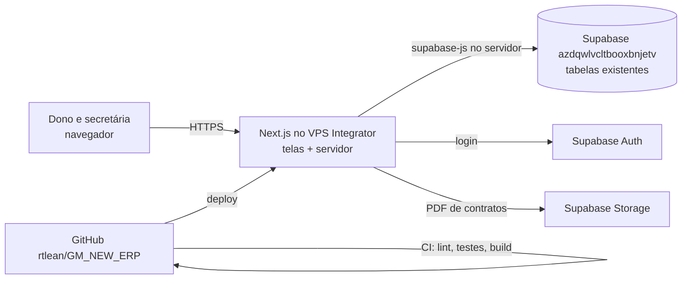

# TRD — Documento Técnico (v1)

## 1. Arquitetura

Um só projeto (Next.js) faz telas e servidor. Não há back-end separado.

## 2. Decisões (ADR resumido)
| # | Decisão | Motivo |
|---|---|---|
| ADR-01 | Next.js + TypeScript + Tailwind | Stack mais comum em vibe coding; um projeto só; fácil de publicar |
| ADR-02 | Supabase `azdqwlvcltbooxbnjetv`, tabelas existentes | Decisão do dono: dados reais desde o início, sem migração |
| ADR-03 | Login pelo Supabase Auth; perfil de `users.role` | Login pronto e seguro; reaproveita os perfis atuais |
| ADR-04 | Banco acessado só no servidor | Chave secreta nunca vai ao navegador; regras de acesso no código |
| ADR-05 | Mudanças de banco só aditivas, SQL versionado | Preserva dados e o histórico |
| ADR-06 | Dinheiro em centavos | Sem erro de arredondamento |
| ADR-07 | Relatório mensal em HTML + impressão do navegador como PDF | Mesmo layout na tela e no PDF |
| ADR-08 | VPS Integrator com Node + PM2 + Nginx + HTTPS (Let's Encrypt) | Domínio e servidor no mesmo lugar, no Brasil |

## 3. Stack
| Camada | Tecnologia |
|---|---|
| App | Next.js 16 (App Router), React 19, TypeScript |
| Estilo | Tailwind CSS 4, fonte Figtree (pacote local, sem depender do Google) |
| Dados | `@supabase/supabase-js` (servidor), `@supabase/ssr` (sessão de login) |
| Testes | Vitest |
| CI | GitHub Actions: lint, testes, build |
| Servidor | Node.js 22 LTS no VPS, PM2, Nginx |

Esta versão do Next.js tem mudanças em relação a versões antigas: siga `AGENTS.md` e a documentação em `node_modules/next/dist/docs/`.

## 4. Ambientes
| Ambiente | Onde | Banco |
|---|---|---|
| Local | `npm run dev` (localhost:3000) | branch de teste do Supabase |
| Produção | VPS Integrator, domínio próprio | Supabase `azdqwlvcltbooxbnjetv` |

## 5. Variáveis de ambiente (`.env.local` no computador; arquivo `.env` no VPS)
| Variável | Exemplo | Público? |
|---|---|---|
| `NEXT_PUBLIC_SUPABASE_URL` | `https://azdqwlvcltbooxbnjetv.supabase.co` | sim |
| `NEXT_PUBLIC_SUPABASE_PUBLISHABLE_KEY` | chave publishable/anon | sim (só para login) |
| `SUPABASE_SECRET_KEY` | chave secret/service role | **não** |

## 6. Segurança
- Toda página (exceto `/login`) exige sessão; checagem no servidor.
- Ações de admin verificam `users.role = 'admin'` no servidor.
- Dados sempre filtrados por `company_id = 1`.
- RLS existente no Supabase não é alterado; o servidor usa a chave secreta e aplica as regras no código.
- HTTPS obrigatório no domínio; firewall do VPS só com portas 22, 80, 443.

## 7. Qualidade
- PR só entra com CI verde.
- Testes obrigatórios: aluguel vigente (mês inteiro), taxa, totais do relatório, validação CPF/CNPJ/telefone, permissões por perfil.
