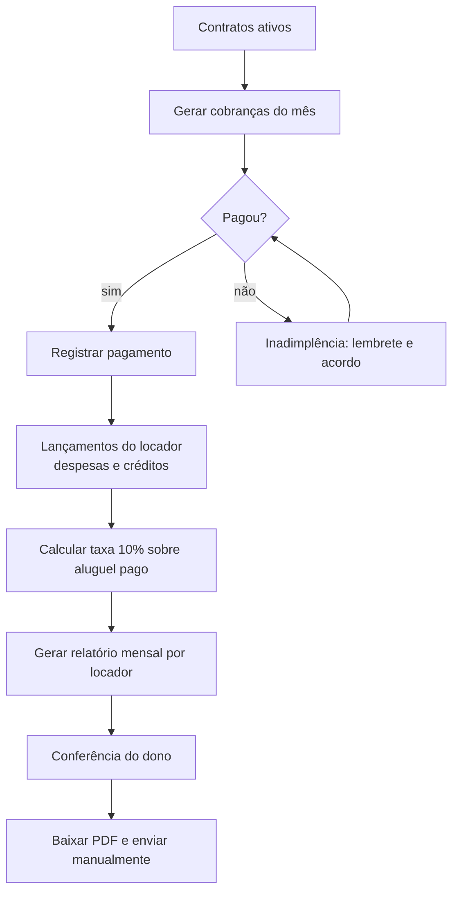
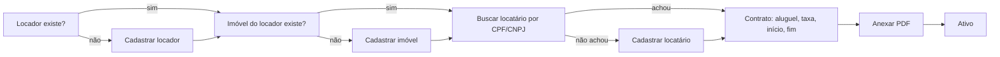

# ERP Flow — Fluxos de operação

## 1. Visão geral do ciclo mensal

## 2. Cadastro de novo contrato

## 3. Alteração de aluguel
1. Usuário escolhe o contrato e o **mês de vigência** (atual ou futuro).
2. Informa o novo valor.
3. Sistema grava em `alteracoes_aluguel` (histórico) e a partir daquele mês a cobrança usa o novo valor **para o mês inteiro**.
4. Mês passado não pode ser escolhido (sem retroativo). Cobrança já paga não é recalculada.

## 4. Encerramento de contrato
Status → `encerrado`, data de fim registrada; não gera cobranças a partir do mês seguinte; histórico preservado.

## 5. Relatório mensal (6 seções, A4 paisagem)
1. Cabeçalho: locador, competência, imobiliária.
2. Aluguéis recebidos por imóvel/locatário.
3. Taxa de administração.
4. Despesas descontadas (cobrar de locador).
5. Créditos/outros lançamentos.
6. Totais e valor líquido do repasse.

Critério: igual ao PDF modelo (ex.: Locatelli 11/2026 — 43.028 / 29.808 / 27.592,49).

## 6. Estados
| Entidade | Estados |
|---|---|
| Contrato | rascunho → ativo → encerrado |
| Cobrança mensal | aberta → paga / atrasada → paga / cancelada |
| Relatório | gerado → conferido |

## 7. Perfis × ações
| Ação | Admin | Operacional |
|---|---|---|
| Cadastros e contratos | ✔ | ✔ |
| Lançamentos e pagamentos | ✔ | ✔ |
| Gerar/enviar relatório | ✔ | ✔ |
| Conferir relatório | ✔ | — |
| Usuários e permissões | ✔ | — |
